# pwn-shop

Tool packages for pwn-broker, built from upstream releases

<picture>
  <source media="(prefers-color-scheme: dark)" srcset="docs/assets/panel-dark.svg">
  
</picture>

<sub>Not a recording: the lines are the ones `build.py` and pwn-broker print for the kerbrute recipe, and every name and value on the right comes from that recipe. Left out: CI testing and publishing the package between the build and `tool install`, pwn-broker's blank lines, and `dist/sums/`; long values are cut with an ellipsis.</sub>

If you use [pwn-broker](https://github.com/Real-Fruit-Snacks/pwn-broker), there is nothing to set up. Inside a box, `tool install` reads this repository's published index, downloads the zip from its release, checks its size and SHA-256 against the index, and installs it for the box:

```text
forest/dc01 > tool install certipy

  ok    python-3.13 3.13.18 installed (runtime, 34 MB)
  ok    certipy 5.1.0 installed
  run   certipy   from any terminal
```

The first Python tool brings the runtime it runs on, as here. `finish` takes the tools off again.

No network on the Kali machine when you want a tool, or you want your own copy: fill a folder while you have one.

```sh
git clone https://github.com/Real-Fruit-Snacks/pwn-shop
sh pwn-shop/fetch.sh ~/pwn-packages
```

It downloads the published index and every zip it names, checks each zip's SHA-256 against the index, and ends with the line to put in `/opt/pwn-broker/config.toml`:

```text
put this line in /opt/pwn-broker/config.toml:
tools_index = "/home/kali/pwn-packages"
```

`fetch.sh` is POSIX `sh`. It needs `curl` and `sha256sum` and no GitHub account, and it changes nothing on the machine except that folder. The folder does not update itself: run `fetch.sh` again after a new build is published.

The [guide](docs/guide.md#getting-the-packages) has the rest, and how to [build the packages yourself](docs/guide.md#building-the-packages-yourself).

pwn-broker keeps a Hack The Box machine in order on Kali Linux, and its `tool install` puts a tool on the machine for one box and takes it off again at `finish`. This repository is where those tools come from. I wanted my own copy of each one, pinned to a version, so that a box I come back to in six months installs the same files, and so that nothing is installed from a package name that can change under it.

## What's in it

| Package | Version | Kind | You get | Licence |
|---|---|---|---|---|
| `certipy` | 5.1.0 | kali | `certipy`, on `python-3.13` | MIT |
| `chisel` | 1.12.0 | both | `chisel`; to upload: `chisel`, `chisel.exe` | MIT |
| `godpotato` | 1.20 | upload | to upload: `GodPotato-NET4.exe`, `GodPotato-NET35.exe` | Apache-2.0 |
| `kerbrute` | 1.0.3 | kali | `kerbrute` | Apache-2.0 |
| `ligolo-ng` | 0.9.2 | both | `ligolo-proxy` (needs root); to upload: `agent`, `agent.exe` | GPL-3.0 |
| `pspy` | 1.2.1 | upload | to upload: `pspy64`, `pspy32`, `pspy64s`, `pspy32s` | GPL-3.0 |
| `peass-ng` | 2026.11.14 | upload | to upload: `linpeas.sh`, `winPEASx64.exe`, `winPEASany.exe`, `winPEAS.bat` | GPL-2.0-or-later with additional terms |
| `runascs` | 1.5 | upload | to upload: `RunasCs.exe`, `RunasCs_net2.exe` | GPL-3.0 |
| `python-3.13` | 3.13.18 | runtime | nothing on PATH; the Python that `certipy` and `targetedkerberoast` run on | PSF-2.0 and others (see its `LICENSE`) |
| `targetedkerberoast` | 2024.12.16 | kali | `targetedKerberoast`, on `python-3.13` | GPL-3.0 |

Kind `kali` puts a command on the machine, `upload` puts files in a folder to carry to the target, and `both` does both. A `runtime` is never installed on its own: it comes and goes with the tools that require it.

`version` is upstream's; `build` is mine, starts at 1, and goes up each time I repackage the same upstream version. A package is named for both: `kerbrute-1.0.3-1.zip`, released under the tag `kerbrute-v1.0.3-1`.

The [guide](docs/guide.md) has the package format, the runtime, `build.py` and CI. [CONTRIBUTING.md](CONTRIBUTING.md) has how to add a tool.

## How a package is made

- A recipe pins each upstream file by its size and SHA-256. No tool binary is committed here.
- The build downloads the file and refuses it if either differs. Nothing is compiled or patched: the files in the zip are upstream's own.
- A Python tool's dependencies are bundled as wheels pinned by hash, and it runs on the `python-3.13` runtime package, not on Kali's own Python, which it never shadows.
- Before anything is published, CI installs every package with pwn-broker's own code, then again inside the Kali image with the network off.
- A published build is never changed. A fix is a new build.

## Tested on

- The unit tests on Windows 11 with Python 3.13, and on Ubuntu 24.04 in CI under Python 3.11, 3.12, 3.13 and 3.14, with warnings treated as errors
- Every package built or downloaded by CI on Ubuntu 24.04, passed `build.py check`, and installed with pwn-broker's own code running on Python 3.12, 3.13 and 3.14, each command started once
- All seven installed inside the official Kali image (Kali 2026.3) with the container's network off, before they were published
- `kerbrute`, `ligolo-ng`, `peass-ng` and `pspy` rebuilt by CI to their published bytes, and `python-3.13` built on Windows and on Ubuntu to the same SHA-256
- `fetch.sh` against the real releases in Kali 2026.2, as a normal user with no GitHub account: every zip matched the index, and pwn-broker then installed three tools from the folder with the network off
- All six tools installed by `tool install` from the published index, by hand in Kali 2026.2 under WSL 2 as root, each command started once, and removed again by `finish`
- Three of them again there as a normal user whose `sudo` asks for a password, `sudo /opt/pwn-broker/bin/ligolo-proxy` included
- `chisel`, `godpotato` and `runascs` built in Kali 2026.2 and installed there from the built folder by a normal user: `chisel` started, the six upload files were in place, and `finish` removed all three
- *Not* tested: any package on a full Kali desktop or against a real target; the Windows files of `chisel`, `godpotato` and `runascs` have not been run anywhere

[docs/tested.md](docs/tested.md) is the full record: counts, runs, commits and dates.

## Known issues

- Packages are x86_64 with glibc only. Build 3 of `certipy` and `targetedkerberoast` carries wheels for its runtime's Python 3.13 only.
- The index and the packages are not signed. The SHA-256 values in the index are the only check: they catch a corrupted or swapped zip, not who published the index.
- `kerbrute` and `pspy` publish no checksums upstream. Their pins are the SHA-256 of each file as first downloaded.
- Kali's own `ligolo-ng` package also installs a command named `ligolo-proxy`. While this package is installed a bare `ligolo-proxy` runs this one, but `sudo` does not use PATH, so `sudo ligolo-proxy` runs Kali's. Use `sudo /opt/pwn-broker/bin/ligolo-proxy`, the path `tool install` prints.
- PEASS-ng's licence has terms beyond the GPL. Read `recipes/peass-ng/LICENSE` before redistributing the package.
- The first Python tool on a machine costs the runtime: a 34 MB download (mebibytes, the unit pwn-broker prints) and about 100 MB unpacked. Its OpenSSL and other libraries are as new as its build: they are fixed when I publish a new build of the runtime, not when Kali updates.

The rest of the list is in [docs/tested.md](docs/tested.md#known-limits).

## Configuration

| Setting | Where | Meaning |
|---|---|---|
| `tools_index` | pwn-broker's `/opt/pwn-broker/config.toml` | Not set: this repository's published index. Or a URL, or a folder that holds `index.toml` and the zips it names |
| `PWN_SHOP_REPO` | environment, for `fetch.sh` | The repository to download from. Default `Real-Fruit-Snacks/pwn-shop` |

## License

[MIT](LICENSE) for this repository's own code. Each package carries the licence of the tool in it, and this project is not affiliated with those projects.
[pwn-broker](https://github.com/Real-Fruit-Snacks/pwn-broker) · [Guide](docs/guide.md) · [Changelog](CHANGELOG.md) · [Security](SECURITY.md) · [Contributing](CONTRIBUTING.md)
